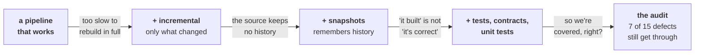

# dbt-exploration

[](https://github.com/markadams31/dbt-exploration/actions/workflows/ci.yml)

dbt (data build tool) turns raw warehouse data into trusted, tested data
assets, with every transformation captured as version-controlled code a team
can collaborate on. Many courses teach you how to start a dbt project. Few
teach you what happens to it six months later.

Six months later is what this repo is about. dbt's
[own structure guide](https://docs.getdbt.com/best-practices/how-we-structure/1-guide-overview)
covers layer naming, grain and file organisation. It says nothing about the
problems that burden data engineers: late-arriving data, backfills,
schema drift, a test failing at 3am. This repo works through each of them
against a live SQL Server 2025 in Docker, measuring what dbt catches and what
gets through.

The lab is one dbt project. A small web shop's warehouse of customers, orders
and payments, plus five notebooks that build it up and then tear into it.
Each notebook opens on something the previous one genuinely cannot handle,
adds one mechanism, and ends with something that runs:



| | notebook | what it adds |
|---|---|---|
| 1 | [foundations](notebooks/01-foundations.ipynb) | models, `ref()`, the four layers, `dbt build` |
| 2 | [when rebuilds stop scaling](notebooks/02-incremental-models.ipynb) | incremental models that survive late-arriving data |
| 3 | [when the source forgets](notebooks/03-snapshots-and-history.ipynb) | snapshots, SCD2 history, point-in-time joins |
| 4 | [proving it's right](notebooks/04-testing-and-contracts.ipynb) | data tests, contracts, unit tests, freshness |
| 5 | [the audit](notebooks/05-the-audit.ipynb) | fifteen defects thrown at the finished project |

Notebooks are committed with their outputs so GitHub renders every query and result without
you installing anything. Re-running a notebook fails loudly if dbt's behaviour changes.

The short version of **notebook 5**: fifteen realistic defects thrown at the 
fully tested project, and seven marts ended up wrong. Four of the
seven raised no error at all. The other three *did* fail the build, and the
marts were wrong anyway, because the alarm rang without standing between the
bad data and the mart. That is the sharpest lesson in the series: **a failing
test is an alarm, not a gate.** Notebook 5 measures exactly when a red build
protects your data and when it doesn't.

## Running it

Open in [Codespaces](https://codespaces.new/markadams31/dbt-exploration), or
VS Code → *Reopen in Container*, then *Run All* in any notebook.

Locally you need [Docker](https://docs.docker.com/get-docker/),
[uv](https://docs.astral.sh/uv/) and Microsoft's ODBC Driver 18
(`winget install Microsoft.msodbcsql.18`, `brew tap microsoft/mssql-release && brew install msodbcsql18`, or
[packages.microsoft.com](https://learn.microsoft.com/sql/connect/odbc/linux-mac/installing-the-microsoft-odbc-driver-for-sql-server)):

```
uv sync
uv run setup     # starts SQL Server, waits until the raw schema is seeded
uv run check     # docker, driver, warehouse, dbt
```

Then open [notebook 1](notebooks/01-foundations.ipynb) in VS Code or any
Jupyter client, with the kernel pointed at the project's `.venv`.
`uv run reset` restores the initial warehouse state at any point;
`uv run teardown --wipe` removes it. The warehouse binds `127.0.0.1:14330`, not 1433,
so it won't collide with an existing SQL Server you may already have.

## How it's put together

| path | role |
|---|---|
| [notebooks/](notebooks/) | the five-part narrative: the actual deliverable |
| [transform/](transform/) | the dbt project they build, break, and audit |
| [src/lab/](src/lab/) | the harness: run dbt from a cell, inject upstream chaos, read run artifacts |
| [docker/](docker/) | SQL Server 2025 container init and the frozen `raw` seed |

## Scope

dbt Core 1.12 with the `dbt-sqlserver` 1.10 adapter, on SQL Server 2025. No dbt
Platform, no Fusion (no SQL Server adapter yet), and no packages: every test
here is one you can read.

Thirty orders, not thirty million. Sized so failure modes stay legible on
screen. Warehouse cost is a real dbt pain and is deliberately *not* covered.
It cannot be demonstrated honestly on a local container. Some behaviour shown
is adapter-specific rather than dbt-specific, notably `on_schema_change`
handling and type widening.
